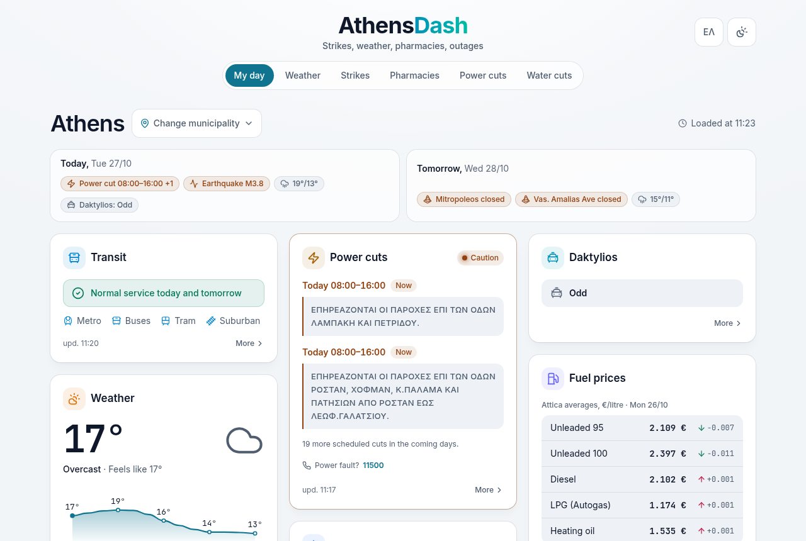
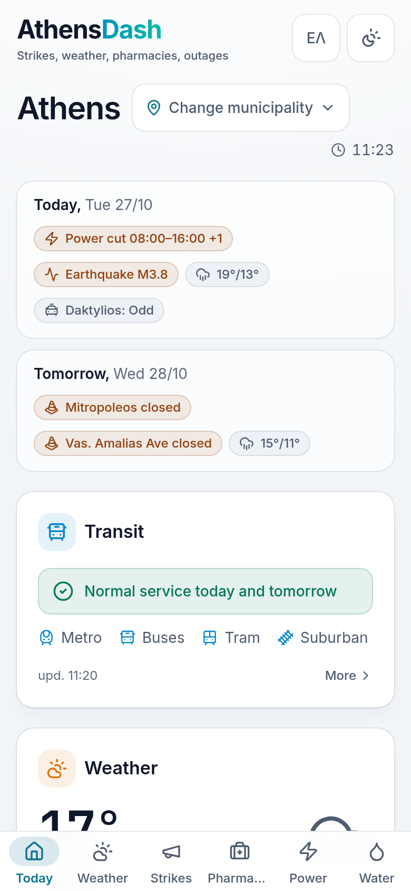

# AthensDash

**Will my day in Athens be disrupted today or tomorrow?** AthensDash answers that in a few seconds.

It brings together everything that can change a normal day in Attica, for the municipality you choose: transport strikes, weather and official warnings, air quality and Saharan dust, fire risk, power and water cuts, road closures and on-duty pharmacies. It's free and needs no account, with no ads and no tracking. It's in Greek, with an English version.

**Live at [athensdash.gr](https://athensdash.gr)** ([English](https://athensdash.gr/en))

> The application source is private. This repository describes what AthensDash does and how it's built, and it will host parts of it released as open source.

  
  

## What's on the page

Each topic is a card. Every card says where its data comes from and when it was last updated, and warns you when the data is out of date. Serious problems also appear in an alert bar at the top, and a short Today / Tomorrow summary sits above the cards. You can reorder or hide cards.

- **Transit.** Strikes, work stoppages and planned closures for the metro, tram, buses, trolleys, suburban rail, ferries and taxis.
- **Weather.** Every one of the 66 municipalities has its own forecast page, refreshed hourly for its own coordinates. It answers a decision rather than listing numbers: will it rain, when, and how sure the forecast is ("28 of 40 model runs show rain in the afternoon").
- **Official warnings** from the national weather service (EMY), read from the European MeteoAlarm feed every 20 minutes and shown unedited.
- **Air quality, dust and fire risk.** The European air quality index, Saharan dust, and Civil Protection's daily fire-risk map.
- **Power and water cuts** from HEDNO and EYDAP, matched to your municipality.
- **On-duty pharmacies** near you or near your municipality's centre.

## Where AI helps

Strikes are the hardest thing to track. There is no single list of them: they are announced in press releases and news articles, in everyday Greek, with phrases like "Wednesday from 11:00 until the end of service". Simple rules can't read them reliably.

AthensDash uses an LLM in production to read these texts, and the same approach for police announcements of road closures and for notices about the Daktylios traffic restriction. Everything else comes straight from each organisation's own published data, with no AI involved.

### How a strike reaches the dashboard

1. **Collect.** Every 10 minutes, the app checks the transport operators (STASY, OASA) and four Greek news sites for new posts.
2. **Filter.** A cheap keyword check keeps only posts that mention both a strike and a form of transport. Most news is dropped here and never reaches the model.
3. **Extract.** The model fills in a fixed JSON schema: the line or mode affected, the day and hours, the kind of disruption, its status (announced, cancelled, postponed, ruled illegal), a one-line note for riders in Greek and English, and the exact sentence from the article that supports it.
4. **Validate.** Every answer is checked: dates and times must be real, and lines must exist. Anything that doesn't fit is discarded.
5. **Merge.** Reports about the same line on the same day become one event. The newest report decides the status, so a later cancellation or court ruling updates the event.
6. **Confirm.** An event counts as confirmed only when the operator announced it or two independent sources agree. Until then it shows as "Awaiting confirmation", and an editor can approve, correct or hide any event.
7. **Show.** The card shows the short note and a link to the original article. Articles are never republished.

### Design choices

- **Articles are untrusted input.** The model can only fill in the schema. It can't browse, run tools or change anything, and its output is validated before it's stored.
- **Provider-independent.** The prompt, schema, validation and budget live in the app. The model call sits behind a small backend interface, so production runs on Gemini with Claude as a fallback, and switching is a configuration change.
- **Fail late, never wrong.** Each pipeline has its own daily call budget. If the model is unavailable or over quota, documents wait and are retried, so an outage makes the dashboard late, not incorrect.
- **Measured, not guessed.** An evaluation task scores the extractor against labelled real articles, so prompt or model changes are compared on the same set. Tests never call a real model.

## Architecture

- **Ingestion is separate from rendering.** About 20 sources each fetch, parse and normalise their data into the database on their own schedule, in background jobs. Every run is logged, so each card knows how fresh it is.
- **Pages never wait on third parties.** Widgets read only local tables, so the page renders in the first response even when a source is down.
- **Privacy is a feature.** No third-party scripts, no tracking cookies and no CDN fonts. Visits are counted without cookies, and visitor locations are never stored. Settings live in a signed cookie.
- **An archive that outlives pruning.** Raw tables are kept small; nightly rollups write monthly aggregates that are never deleted, and recompute idempotently so a missed night heals itself.
- **Fast and accessible.** Server-rendered SVG charts with no chart library, self-hosted fonts with full Greek coverage, and status that never relies on colour alone.

## Stack

Ruby 4.0 · Rails 8.1 · SQLite (replicated with Litestream) · Solid Queue, Solid Cache and Solid Cable · Hotwire (Turbo + Stimulus) · Tailwind CSS v4 · Gemini and Claude APIs · Minitest · Kamal, behind Cloudflare.
